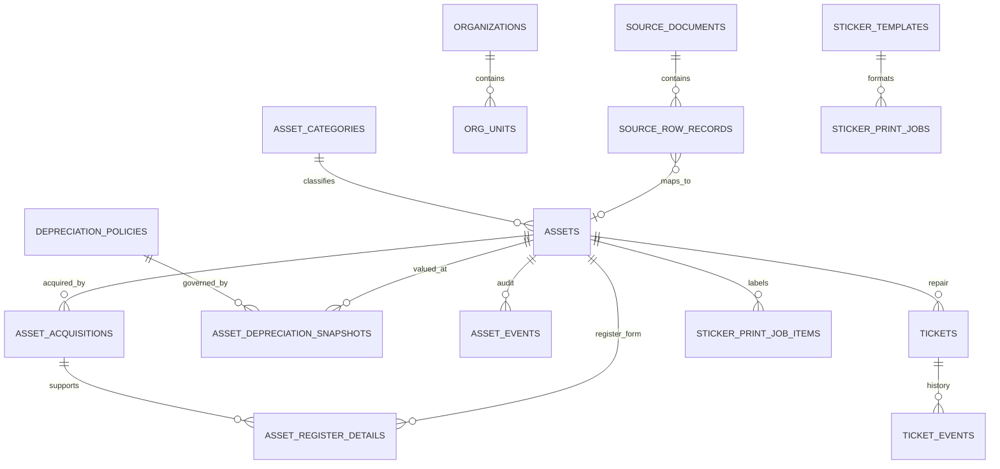

# GovAsset — ระบบทะเบียนครุภัณฑ์ภาครัฐ (ต้นแบบ SQLite)

ต้นแบบนี้อยู่ใน repository แยกจากแอป Next.js หลัก ใช้ Python HTTP server + SQLite เป็นฐานทดลอง มีหน้าเว็บภาษาไทย โทนกรมท่า/teal แบบทางการ ฟอนต์เริ่มต้นใหญ่ขึ้น ปุ่ม A−/A+ หน้าพิมพ์ทะเบียนคุม/ใบแจ้งซ่อม/สติกเกอร์ และตรา GovAsset พร้อมเครดิต **POWER BY PNG TEAM**

> **การแยกข้อมูล:** ไฟล์ฐานข้อมูลที่นำเข้าจากเอกสารผู้ใช้ถูกเก็บไว้นอก repository และไม่ถูกส่งขึ้น GitHub หรือ preview สาธารณะ หน้า preview ใช้ฐาน SQLite สังเคราะห์เท่านั้น ฐานนำเข้ามีข้อมูลจากเอกสารที่ผู้ใช้ให้ จึงต้องถือเป็นข้อมูลส่วนตัว/ภายในหน่วยงาน

## จัดการหมวดและหลักเกณฑ์ค่าเสื่อม

- เพิ่ม/แก้ไข/ปิดใช้งาน/กู้คืนหมวดครุภัณฑ์ได้ พร้อมหมวดแม่และหมายเหตุ; แสดงจำนวนครุภัณฑ์/กฎค่าเสื่อมที่เชื่อมอยู่
- เพิ่ม/แก้ไข/ปิดใช้งาน/กู้คืนหลักเกณฑ์ค่าเสื่อมได้ แก้เลขลำดับ ประเภท อายุใช้งาน อัตราร้อยละต่อปี มูลค่าคงเหลือ วิธีคำนวณ ขอบเขต/หมายเหตุ และเชื่อมกับหลายหมวด
- เลือกวิธีคำนวณได้ 3 แบบ: ใช้อัตราต่อปีที่หน่วยงานกำหนด, เส้นตรงตามอายุใช้งาน หรือพิจารณาเป็นรายกรณี พร้อมตัวอย่างคำนวณจากราคาทุนที่ปรับทดสอบได้
- การเปลี่ยนหลักเกณฑ์ไม่แก้ snapshot ค่าเสื่อมเดิมย้อนหลัง; ค่าประวัติยังเชื่อม policy ID และเก็บประวัติเวอร์ชัน master data แยกใน `master_data_events`
- ปุ่ม “ลบ” เป็น **soft delete**: ปิดใช้งานโดยเก็บ foreign keys/ประวัติไว้; เปิด “แสดงที่ปิดใช้งาน” เพื่อกู้คืน
- ทุก create/update/delete/restore บันทึกใน `master_data_events` พร้อมค่าก่อน–หลังและผู้บันทึก (บทบาทผู้บันทึกใน prototype ยังไม่ใช่ authentication)
- ฐานเปล่าที่ใช้ preview เติมตัวอย่างหมวดและกฎ 3 แถวเพื่อทดสอบ CRUD; ฐานที่นำเข้าจากไฟล์แนบยังคงชุดข้อมูลจริงที่นำเข้าและไม่เติมตัวอย่างซ้ำ

## ข้อมูลทดลองและการเชื่อมโยง

ฐาน SQLite ชุดที่สร้างจากไฟล์แนบประกอบด้วยข้อมูลนำเข้าแบบสัมพันธ์ รวมแถวต้นฉบับไว้ตรวจสอบย้อนกลับ:

- Workbook 19 ไฟล์จาก archive: **66,395 ระเบียนครุภัณฑ์** และแถวต้นทาง 66,395 แถว เก็บค่าเดิมใน `source_row_records.raw_data_json` เพียงจุดเดียว แล้วเชื่อม asset ด้วย `asset_id`
- คู่มือออกเลขครุภัณฑ์: **825 รายการ FSN**; มี **410 รายการทรัพย์สินที่จับคู่ FSN ได้** ด้วยรหัสจากเอกสาร/การจับคู่แบบ prefix ซึ่งควรตรวจสอบก่อนใช้เป็นรหัสทางการ
- ตารางอายุและค่าเสื่อม: **30 หลักเกณฑ์** เชื่อม snapshot ของทรัพย์สินที่จับคู่ได้
- แบบทะเบียนคุม PDF: ข้อความที่ตรวจอ่านได้ถูกจัดเก็บเป็น `asset_register_details` และเชื่อมกับรายการที่จับคู่รหัสได้ **1 รายการ**; เป็นการอ่านจากเอกสารสแกน/ต้องตรวจทานต้นฉบับก่อนนำไปใช้
- Archive หมวดครุภัณฑ์: เก็บชื่อหมวด/ไฟล์ต้นทาง 19 ชุด ไม่คัดลอกข้อมูลทุกแถวซ้ำลงฐาน

ผลตรวจฐานข้อมูลขณะสร้าง: `PRAGMA integrity_check=ok`, foreign-key violations **0**; พบแถวรหัสซ้ำ 5 แถว และ 1 แถวไม่มีรหัส อ่านรายละเอียดได้จาก `import_warnings` และ raw source โดยไม่ทิ้งระเบียนต้นทาง ไฟล์ DB ถูก normalize ให้ raw JSON ไม่ซ้ำใน assets/acquisitions/depreciation tables; ขนาด SQLite ที่ส่งมอบประมาณ 380 MB (ก่อนบีบอัด)

## เริ่มเซิร์ฟเวอร์

ต้องใช้ Python 3.10+ และติดตั้ง dependency QR (อาจใช้ `pip install -r requirements.txt`):

```bash
# รันจาก repository root
python3 -m pip install -r requirements.txt
ASSET_DB_PATH=/absolute/path/itam-sample.sqlite3 PORT=8000 python3 server.py
```

เปิด `http://localhost:8000` โดย server bind ที่ `0.0.0.0` ค่าเริ่มต้นฐานเปล่า/สาธิตคือ `data/prototype.sqlite3` หากใช้ฐานนำเข้าจากชุดแนบ ให้นำไฟล์ SQLite ส่งมอบไปไว้ใน path ที่ตั้งเป็น `ASSET_DB_PATH` ก่อนเริ่มแอป **อย่าใช้ path นี้กับหน้า preview สาธารณะ**

ปรับวงเงินและพอร์ตได้ด้วย environment variables:

```bash
ASSET_DB_PATH=/data/govasset.sqlite3 \
PORT=8080 \
REPAIR_APPROVAL_THRESHOLD=5000 \
python3 server.py
```

วงเงิน 5,000 บาทเป็น **ค่าทดลองเท่านั้น ไม่ใช่วงเงินจริงหรือระเบียบของหน่วยงาน** ระบบเสนอให้ส่งอนุมัติเมื่อเจ้าหน้าที่ระบุว่าซื้ออะไหล่ ส่งซ่อมภายนอก พิจารณาทดแทน/จำหน่าย หรือยอดถึงวงเงิน

## Relational schema เบื้องต้น

ดูรายละเอียด DDL ใน [`schema.sql`](schema.sql) โครงสร้างหลัก:



- `source_documents` / `source_document_pages` / `source_columns` / `source_row_records`: ที่มา, หน้า/หัวคอลัมน์ และข้อมูลต้นฉบับทุกแถว รวมแถวที่ map ไม่ได้; `source_row_search` เป็น external-content FTS5 trigram index ไม่ทำสำเนา raw text และ trigger ดูแลแถวใหม่/แก้ไข
- `organizations` / `org_units` / `asset_categories` / `fsn_catalog_items` / `asset_fsn_matches`: โครงสร้างหน่วยงาน หมวด และบัญชี FSN พร้อมวิธีจับคู่; หมวดมีสถานะ `is_active` และปิดใช้งานแบบเก็บ foreign keys
- `assets`: ระเบียนหลัก; acquisition, PDF register และค่าเสื่อมเก็บในตารางลูก ไม่ทำสำเนา raw source ซ้ำ
- `asset_acquisitions` → `asset_register_details` และ `asset_depreciation_snapshots` → `depreciation_policies`: เชื่อมข้อมูลจัดซื้อ แบบทะเบียน และหลักเกณฑ์ค่าเสื่อม; policy เก็บ `calculation_method`, อายุ, อัตราต่อปี, มูลค่าคงเหลือและสถานะใช้งาน
- `asset_category_policy_links`: เชื่อมหลักเกณฑ์ค่าเสื่อมกับหมวดได้หลายต่อหลาย; `master_data_events` บันทึก create/update/delete/restore พร้อมค่าก่อน–หลัง
- `tickets` → `ticket_events` และ `asset_events`: Ticket ซ่อม, audit trail และเหตุการณ์ทะเบียน
- `sticker_templates` / `sticker_settings` / `sticker_print_jobs` / `sticker_print_job_items`: แบบฉลาก ค่าพิมพ์ และประวัติฉลากที่สร้าง

เส้นทางข้อมูลต่อทะเบียนคุมได้จากหน้า **ทะเบียนคุม → ตรวจข้อมูลต้นทางและการเชื่อมโยง** รวม source filename/row, acquisition, depreciation snapshot และ FSN matches

## ฟังก์ชันที่ทดลองได้

### ทะเบียน / การค้นหา / FSN / ค่าเสื่อม

- ค้นหาและแบ่งหน้า `/api/inventory` รองรับคำค้นในฟิลด์ทะเบียน และใช้ FTS5 trigram ค้น raw source rows สำหรับคำตั้งแต่ 3 ตัวอักษรขึ้นไป (คำสั้นค้นในฟิลด์ที่ normalize ไว้)
- หน้า **บัญชีรหัส FSN** ค้นและแบ่งหน้ารายการจาก PDF (825 รายการ) พร้อมหน้าอ้างอิง; **อายุ/ค่าเสื่อม** อ่าน 30 ข้อจาก PDF ที่แนบ
- หน้า **ทะเบียนคุม** เลือกทรัพย์สิน แสดงค่าจาก workbook/PDF ที่เชื่อมได้ จัดหน้า A4 แนวนอน 12 คอลัมน์ตามเอกสารและพิมพ์เฉพาะแบบฟอร์ม
- เพิ่มรายการใหม่ส่งเข้าคิวอนุมัติใน workflow ตัวอย่าง

### วงจรแจ้งซ่อมและ Ticket

ผู้แจ้งเปิดคำขอและได้เลข `SR-ปีพุทธศักราช-ลำดับ` → เจ้าหน้าที่พัสดุคัดกรอง → งานทั่วไปไปคิวมอบหมาย หรือรายการที่เข้าเงื่อนไขไปผู้อนุมัติ → เจ้าหน้าที่มอบหมายช่าง → ช่างบันทึกรออะไหล่/ผลซ่อม/ค่าใช้จ่าย → หากยอดจริงสูงกว่ายอดอนุมัติให้ผู้อนุมัติตรวจเพิ่ม → ผู้แจ้งตรวจรับและปิดงานหรือส่งกลับแก้ไข

ค้นหา Ticket ได้จากเลข Ticket, ครุภัณฑ์, อาการ, สถานที่, ผู้แจ้ง, ผู้รับผิดชอบ และสถานะ ดู timeline แล้วย่อ/พิมพ์ใบแจ้งซ่อม A4, A5, 80 มม. หรือ 58 มม. การอนุมัติเป็นตัวอย่าง ไม่ใช่บันทึกทางราชการ

### Sticker Studio — อิงรูปแบบ ITAM

นำแนวคิด data contract/หน่วย mm/variable-based template และพฤติกรรมพิมพ์หลายรายการจาก ITAM ใน repository มาใช้ในต้นแบบ:

- ค้นหา/เลือกทรัพย์สินหลายรายการ, เชื่อมตัวแปรจากทะเบียน
- สร้างและแก้เทมเพลต; canvas กำหนดเอง **5–500 มม.** (กว้าง × สูง)
- วาง/ลากองค์ประกอบข้อความ, QR, กรอบ/แถบสี และภาพ URL; แก้ตำแหน่ง ขนาด หมุน สี/แนวข้อความ
- รองรับ placeholders เช่น `{{AssetNo}}`, `{{AssetName}}`, `{{Location}}`, `{{PurchasePrice}}`, `{{WarrantyEnd}}`, `{{QrUrl}}`
- บันทึกแบบหลักและค่าหน่วยงานใน SQLite; การพิมพ์สร้าง QR แบบ SVG และบันทึก `sticker_print_jobs` / items
- หนึ่งฉลากต่อหนึ่งหน้าโดยใช้ขนาด canvas จริง; ตรวจ print dialog/driver และทดลองกับเครื่องพิมพ์ก่อนผลิตจริง

## การ import ซ้ำ

`import_sources.py` รองรับ Workbook 19 ไฟล์, RAR, FSN PDF, ค่าเสื่อม PDF และทะเบียน PDF พร้อมบันทึก provenance. เตรียม dependency ด้วย `python3 -m pip install -r requirements-import.txt -r requirements.txt` และส่ง `register-json` ที่ตรวจ OCR จากทะเบียนสแกนแล้วให้ importer ดูตัวเลือกทั้งหมดด้วย:

```bash
python3 import_sources.py --help
```

การ import แบบ `--replace` จะสร้างฐานข้อมูลใหม่ ให้สำรองไฟล์ก่อนเสมอและ **ห้ามรันกับฐาน production** ตัวอย่างฐานที่ส่งมอบถูกสร้างจากไฟล์แนบของผู้ใช้โดยตรง ไม่ได้ commit ขึ้น Git

## Deploy บน Railway

มี `Dockerfile` ที่ root ของ repository. สำหรับ repo แยกนี้ ให้ตั้ง Railway **Root Directory** เป็น `/` (root/default); หากนำโค้ดกลับเข้า monorepo ITAM-NextJS ให้ตั้งเป็น `/prototypes/gov-asset-coding`. สร้าง Volume ที่ mount path `/data`, ตั้ง:

```text
ASSET_DB_PATH=/data/govasset.sqlite3
REPAIR_APPROVAL_THRESHOLD=5000
```

ใช้ `PORT` ที่ Railway กำหนดและ health check `/api/health` แนบ DB ที่ส่งมอบเข้ากับ volume ผ่านการโอนที่ปลอดภัยก่อนเปิดใช้จริง ไฟล์ฐานนำเข้าปัจจุบันประมาณ 380 MB; สำหรับทดสอบควรเผื่อ volume อย่างน้อย 1 GB และเก็บ backup แยกนอก volume อ่าน [Railway Volumes](https://docs.railway.com/volumes) เพื่อยืนยัน path/พฤติกรรมคงอยู่หลัง deploy/restart; ตั้งหนึ่ง replica สำหรับ SQLite

> **อย่าเปิดฐานที่มีข้อมูลแนบหรือข้อมูลราชการจริงบน public Railway จากต้นแบบนี้** เพราะยังไม่มี authentication/authorization, session, network controls, backup/restore, secrets management หรือ security review แม้ UI จะเปลี่ยน role ได้ แต่ API ไม่บังคับสิทธิ์

## ข้อจำกัดและการตรวจทาน

- ข้อมูลแนบเป็นข้อมูลจริงที่ผู้ใช้ให้มาทำชุดทดลอง; preview ออนไลน์ใช้ฐานสังเคราะห์แยกต่างหาก
- พบ 5 แถวรหัสซ้ำและ 1 แถวรหัสว่าง; ระบบเก็บครบและไม่เดารหัสแทน ให้เจ้าหน้าที่ตรวจสอบก่อน reconcile
- มี 410 FSN auto-matches; การ match เป็น candidate ไม่ใช่การรับรองเลขทางราชการ
- รายการทะเบียนคุมที่อ่านจาก PDF สแกนจับคู่ได้หนึ่งรายการ; โปรดเทียบภาพ/ต้นฉบับก่อนใช้
- ตารางค่าเสื่อมเป็นเอกสารของ **สำนักงานปลัดกระทรวงสาธารณสุข** ไม่ใช่หลักเกณฑ์กลางทุกหน่วยงาน
- ไม่มี login/session, authorization จริง, SLA/ตารางเวร, notification, แนบรูป, e-signature หรือเชื่อมการเงิน/พัสดุ; ปุ่มและ role เป็น workflow simulation
- ไม่ commit ไฟล์ `.sqlite3`, `.db`, WAL/SHM หรือไฟล์ข้อมูลต้นทางเข้าระบบ version control

## ไฟล์สำคัญ

- `index.html`, `styles.css`, `stickers.css`, `app.js`, `asset-tools.js`: UI และ interaction
- `server.py`, `asset_api.py`: HTTP/REST และ queries/Sticker rendering
- `schema.sql`: relational DDL
- `import_sources.py`: ตัวนำเข้าจากเอกสารและ workbooks
- `MANUAL.md`: คู่มือทดลอง
- `Dockerfile`, `requirements.txt`: image สำหรับ Railway + QR dependency · `requirements-import.txt`: parser workbook สำหรับงานนำเข้าซ้ำ

## แหล่งอ้างอิง

- ไฟล์แนบของผู้ใช้: `คู่มือการออกเลขครุภัณฑ์.pdf`, `ตารางกำหนดอายุการใช้งานและอัตราค่าเสื่อ.pdf`, `ทะเบียนคุมทรัพย์สิน(2).pdf`, และ `ครุภัณฑ์แยกประเภท.rar`
- Railway [Deploying a Monorepo](https://docs.railway.com/deployments/monorepo) · [Using Volumes](https://docs.railway.com/volumes)
- DGA, [มาตรฐานเว็บไซต์ภาครัฐ เวอร์ชัน 2.0](https://standard.dga.or.th/wp-content/uploads/2024/12/%E0%B8%A1%E0%B8%B2%E0%B8%95%E0%B8%A3%E0%B8%90%E0%B8%B2%E0%B8%99%E0%B9%80%E0%B8%A7%E0%B9%87%E0%B8%9A%E0%B8%A0%E0%B8%B2%E0%B8%84%E0%B8%A3%E0%B8%B1%E0%B8%90-2.0.pdf)
- [W3C WCAG 2.2 — Contrast Minimum](https://www.w3.org/WAI/WCAG22/Understanding/contrast-minimum.html)
