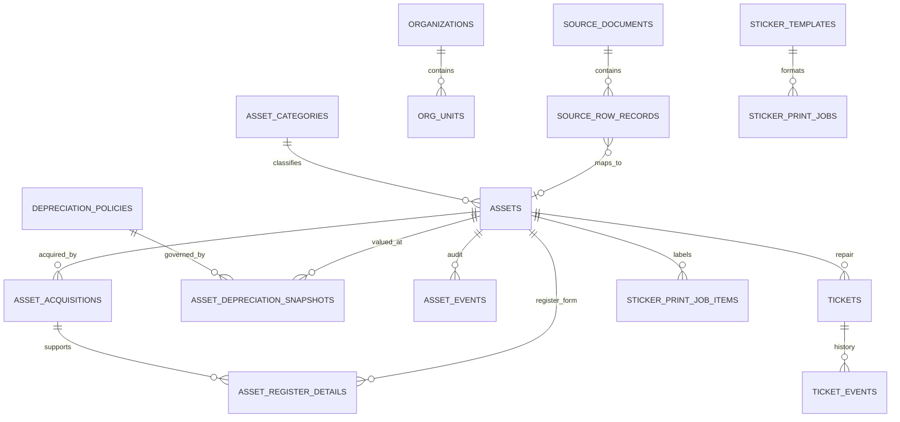

# Smart-Asset — ระบบทะเบียนครุภัณฑ์ภาครัฐบนโครงสร้าง GovAsset เดิม

โครงสร้างหลักคือ **Python + SQLite + HTML/CSS/JavaScript** ตามต้นแบบ GovAsset ใช้ ITAM เป็นตัวอย่างสำหรับเสริมฟังก์ชัน ไม่มีการย้ายแอปหลักเป็น Next.js เวอร์ชัน Next.js ที่ทดลองถูกเก็บใน branch `archive/itam-based-smart-asset` เพื่ออ้างอิงและกู้คืนได้

**เริ่มรันบน Windows/VS Code:** อ่าน [คู่มือ Local](docs/LOCAL-DEVELOPMENT.md) ใช้ Python 3.12 และเปิดที่ `http://localhost:8000` ไม่ต้องใช้ Bun/Prisma ชื่อและโลโก้ในแอปแก้ได้จากเมนูตั้งค่า โดยเครดิต `POWER BY PNG TEAM` คงเป็นสีส้ม


ต้นแบบนี้อยู่ใน repository แยกจากแอป Next.js หลัก ใช้ Python HTTP server + SQLite เป็นฐานทดลอง มีหน้าเว็บภาษาไทย โทนกรมท่า/teal แบบทางการ ฟอนต์เริ่มต้นใหญ่ขึ้น ปุ่ม A−/A+ หน้าพิมพ์ทะเบียนคุม/ใบแจ้งซ่อม/สติกเกอร์ และตรา GovAsset พร้อมเครดิต **POWER BY PNG TEAM**

> **การแยกข้อมูล:** ไฟล์ฐานข้อมูลที่นำเข้าจากเอกสารผู้ใช้ถูกเก็บไว้นอก repository และไม่ถูกส่งขึ้น GitHub หรือ preview สาธารณะ หน้า preview ใช้ฐาน SQLite สังเคราะห์เท่านั้น ฐานนำเข้ามีข้อมูลจากเอกสารที่ผู้ใช้ให้ จึงต้องถือเป็นข้อมูลส่วนตัว/ภายในหน่วยงาน

อ่าน [คู่มือหมวดและการออกเลข FSN](docs/FSN-GUIDE.md): FSN 4–3–4 ใช้จำแนกคุณลักษณะ ส่วนเลขประจำครุภัณฑ์และ QR แยกตามชิ้น ไม่เพิ่มเลขชุดรายละเอียดเมื่อซื้ออุปกรณ์คุณลักษณะเดิมเพิ่ม

หากดาวน์โหลดฐานจากแชตไม่ได้ ให้สร้างฐานบน Local จาก Excel ที่แตกจาก RAR และ PDF คู่มือด้วยตัวช่วย `scripts/import-local.py --run` อ่านขั้นตอนใน [คู่มือ Local](docs/LOCAL-DEVELOPMENT.md#สร้างฐานจริงจากเอกสารบน-windows-โดยตรง) ตัวช่วยเลือกไฟล์ผ่านหน้าต่างบน Windows และสร้างฐานใหม่โดยไม่เขียนทับฐานเดิม

## แจ้งเตือนและอนุมัติ

มีบัญชีตั้งต้น **19 หมวด** และความสัมพันธ์หมวด/รหัส **1,918 รายการ** จากข้อมูลแยกประเภทที่ผู้ใช้ให้มา ติดตั้งอัตโนมัติเมื่อเริ่มเซิร์ฟเวอร์ เลือกหมวดแล้วมีชนิดและรหัสเดิมให้ใช้ทันที โดยไม่ต้องนำเข้าทะเบียนรายชิ้นก่อน ดู [ที่มาของบัญชีตั้งต้น](reference-data/README.md)

แก้ไขคำอธิบายและเงื่อนไขของหลักเกณฑ์ หมวด และรหัสได้ใน **ตั้งค่า → จัดการเลขครุภัณฑ์** พร้อมเก็บข้อความต้นฉบับ ประวัติการแก้ไข และป้องกันการเขียนทับเมื่อแก้พร้อมกัน อ่านขั้นตอนใน [คู่มือ](MANUAL.md#แก้ไขข้อความและเงื่อนไขที่ใช้ประกอบการออกเลข)

การเพิ่มครุภัณฑ์เลือก **หมวดและชื่อชนิด/คุณลักษณะ** ระบบเติมรหัสชุดที่ 1–3 ให้ แล้วออกลำดับประจำชิ้นชุดที่ 4 จากทะเบียนทั้งหมด แยกบัญชีอ้างอิง PDF ออกจากรหัสที่ใช้จริง/บัญชีหน่วยงาน พร้อมแสดงที่มาและรักษาเลขเดิมรูปแบบพิเศษ จัดการบัญชีแยกที่ **ตั้งค่า → จัดการเลขครุภัณฑ์** อ่าน [คู่มือหมวดและเลขครุภัณฑ์](docs/FSN-GUIDE.md)

รูปกระดิ่งเปิดงานล่าสุดตามบทบาท กดไปยังใบซ่อม คิวขึ้นทะเบียน หรือ PM/ตรวจนับได้ มีจำนวนยังไม่อ่าน สถานะอ่านใน SQLite และการเตือนใกล้ครบกำหนด/เกินกำหนด ขั้นอนุมัติใหม่จะแจ้งใหม่แม้อ่านขั้นก่อนหน้าแล้ว ตั้งค่าเกณฑ์ส่งอนุมัติและวันเตือนล่วงหน้าได้ในหน้าตั้งค่า โดยเก็บประวัติและ revision ของการแก้ไข เกณฑ์ตอนคัดกรองถูกบันทึกกับ Ticket เพื่อใช้ตรวจยอดจริง รองรับกล่องแจ้งเตือนในแอปและ LINE Messaging API แบบเลือกเปิด โดยกำหนดผู้รับตามบทบาท/กลุ่มในหน้าตั้งค่า อ่านวิธีเชื่อมต่อใน [คู่มือ LINE](docs/LINE-NOTIFICATIONS.md) บทบาทยังเป็นแบบจำลอง ไม่มีการยืนยันตัวบุคคล อ่านรายละเอียดใน [คู่มือ](MANUAL.md#ศูนย์แจ้งเตือนและการอนุมัติ)

## จัดการหมวดและหลักเกณฑ์ค่าเสื่อม

- เพิ่ม/แก้ไข/ปิดใช้งาน/กู้คืนหมวดครุภัณฑ์ได้ พร้อมหมวดแม่และหมายเหตุ; แสดงจำนวนครุภัณฑ์/กฎค่าเสื่อมที่เชื่อมอยู่
- เพิ่ม/แก้ไข/ปิดใช้งาน/กู้คืนหลักเกณฑ์ค่าเสื่อมได้ แก้เลขลำดับ ประเภท อายุใช้งาน อัตราร้อยละต่อปี มูลค่าคงเหลือ วิธีคำนวณ ขอบเขต/หมายเหตุ และเชื่อมกับหลายหมวด
- เลือกวิธีคำนวณได้ 3 แบบ: ใช้อัตราต่อปีที่หน่วยงานกำหนด, เส้นตรงตามอายุใช้งาน หรือพิจารณาเป็นรายกรณี พร้อมตัวอย่างคำนวณจากราคาทุนที่ปรับทดสอบได้
- การเปลี่ยนหลักเกณฑ์ไม่แก้ snapshot ค่าเสื่อมเดิมย้อนหลัง; ค่าประวัติยังเชื่อม policy ID และเก็บประวัติเวอร์ชัน master data แยกใน `master_data_events`
- ปุ่ม “ลบ” เป็น **soft delete**: ปิดใช้งานโดยเก็บ foreign keys/ประวัติไว้; เปิด “แสดงที่ปิดใช้งาน” เพื่อกู้คืน
- ทุก create/update/delete/restore บันทึกใน `master_data_events` พร้อมค่าก่อน–หลังและผู้บันทึก (บทบาทผู้บันทึกใน prototype ยังไม่ใช่ authentication)
- ฐานเปล่าที่ใช้ preview เติมตัวอย่างหมวดและกฎ 3 แถวเพื่อทดสอบ CRUD; ฐานที่นำเข้าจากไฟล์แนบยังคงชุดข้อมูลจริงที่นำเข้าและไม่เติมตัวอย่างซ้ำ

## ข้อมูลทดลองและการเชื่อมโยง

ฐาน SQLite ชุดที่สร้างจากไฟล์แนบประกอบด้วยข้อมูลนำเข้าแบบสัมพันธ์ รวมแถวต้นฉบับไว้ตรวจสอบย้อนกลับ:

- Workbook 19 ไฟล์จาก archive: **66,394 ระเบียนครุภัณฑ์** และหัวตาราง Software ที่เก็บแยก 1 แถว รวมแถวต้นทาง 66,395 แถว เก็บค่าเดิมใน `source_row_records.raw_data_json` เพียงจุดเดียว แล้วเชื่อม asset ด้วย `asset_id`
- คู่มือออกเลขครุภัณฑ์: **825 รายการ FSN**; มี **410 รายการทรัพย์สินที่จับคู่ FSN ได้** ด้วยรหัสจากเอกสาร/การจับคู่แบบ prefix ซึ่งควรตรวจสอบก่อนใช้เป็นรหัสทางการ
- ฐานรอบนี้มาจาก RAR และคู่มือ FSN เท่านั้น ยังไม่มี PDF หลักเกณฑ์ค่าเสื่อมจึงไม่สร้างกฎขึ้นเอง; ค่าอายุ/ยอดค่าเสื่อมที่มีใน Excel ยังเก็บใน snapshot ต้นทาง
- แบบทะเบียนคุม PDF ใช้อ้างอิงหน้าตาเอกสาร การนำเข้า 2 ชุดรอบนี้ยังไม่เชื่อมข้อมูลสแกนเข้ากับครุภัณฑ์รายชิ้น เพราะไม่มี JSON ที่ตรวจทานแล้ว
- Archive หมวดครุภัณฑ์: เก็บชื่อหมวด/ไฟล์ต้นทาง 19 ชุด ไม่คัดลอกข้อมูลทุกแถวซ้ำลงฐาน

ผลตรวจฐานข้อมูลขณะสร้าง: `PRAGMA integrity_check=ok`, foreign-key violations **0**; พบแถวรหัสซ้ำ 5 แถว และ 1 แถวไม่มีรหัส อ่านรายละเอียดได้จาก `import_warnings` และ raw source โดยไม่ทิ้งระเบียนต้นทาง ไฟล์ DB ถูก normalize ให้ raw JSON ไม่ซ้ำใน assets/acquisitions/depreciation tables; ขนาด SQLite ที่ส่งมอบประมาณ 380 MB (ก่อนบีบอัด)

## เริ่มเซิร์ฟเวอร์

ต้องใช้ Python 3.10+ และติดตั้ง dependency QR (อาจใช้ `pip install -r requirements.txt`):

```bash
# รันจาก repository root
python3 -m pip install -r requirements.txt
ASSET_DB_PATH=/absolute/path/itam-sample.sqlite3 PORT=8000 python3 server.py
```

เปิด `http://localhost:8000` โดย server bind ที่ `0.0.0.0` ค่าเริ่มต้นฐานเปล่า/สาธิตคือ `data/prototype.sqlite3` หากใช้ฐานนำเข้าจากชุดแนบ ให้นำไฟล์ SQLite ส่งมอบไปไว้ใน path ที่ตั้งเป็น `ASSET_DB_PATH` ก่อนเริ่มแอป **อย่าใช้ path นี้กับหน้า preview สาธารณะ**

พอร์ตกำหนดด้วย environment variables ส่วน `REPAIR_APPROVAL_THRESHOLD` ใช้ตั้งวงเงินเริ่มต้นเฉพาะฐานที่ยังไม่มีค่าเกณฑ์ หลังจากนั้นแก้ได้ในหน้า **ตั้งค่า → แจ้งเตือนและเกณฑ์ส่งอนุมัติ**:

```bash
ASSET_DB_PATH=/data/govasset.sqlite3 \
PORT=8080 \
REPAIR_APPROVAL_THRESHOLD=5000 \
python3 server.py
```

วงเงิน 5,000 บาทเป็น **ค่าทดลองเท่านั้น ไม่ใช่วงเงินจริงหรือระเบียบของหน่วยงาน** ระบบเสนอให้ส่งอนุมัติเมื่อเจ้าหน้าที่ระบุว่าซื้ออะไหล่ ส่งซ่อมภายนอก พิจารณาทดแทน/จำหน่าย หรือยอดถึงวงเงิน

## Relational schema เบื้องต้น

ดูรายละเอียด DDL ใน [`schema.sql`](schema.sql) โครงสร้างหลัก:



- `source_documents` / `source_document_pages` / `source_columns` / `source_row_records`: ที่มา, หน้า/หัวคอลัมน์ และข้อมูลต้นฉบับทุกแถว รวมแถวที่ map ไม่ได้; `source_row_search` เป็น external-content FTS5 trigram index ไม่ทำสำเนา raw text และ trigger ดูแลแถวใหม่/แก้ไข
- `organizations` / `org_units` / `asset_categories` / `fsn_catalog_items` / `asset_fsn_matches`: โครงสร้างหน่วยงาน หมวด และบัญชี FSN พร้อมวิธีจับคู่; หมวดมีสถานะ `is_active` และปิดใช้งานแบบเก็บ foreign keys
- `assets`: ระเบียนหลัก; acquisition, PDF register และค่าเสื่อมเก็บในตารางลูก ไม่ทำสำเนา raw source ซ้ำ
- `asset_acquisitions` → `asset_register_details` และ `asset_depreciation_snapshots` → `depreciation_policies`: เชื่อมข้อมูลจัดซื้อ แบบทะเบียน และหลักเกณฑ์ค่าเสื่อม; policy เก็บ `calculation_method`, อายุ, อัตราต่อปี, มูลค่าคงเหลือและสถานะใช้งาน
- `asset_category_policy_links`: เชื่อมหลักเกณฑ์ค่าเสื่อมกับหมวดได้หลายต่อหลาย; `master_data_events` บันทึก create/update/delete/restore พร้อมค่าก่อน–หลัง
- `tickets` → `ticket_events` และ `asset_events`: Ticket ซ่อม, audit trail และเหตุการณ์ทะเบียน
- `sticker_templates` / `sticker_settings` / `sticker_print_jobs` / `sticker_print_job_items`: แบบฉลาก ค่าพิมพ์ และประวัติฉลากที่สร้าง

เส้นทางข้อมูลต่อทะเบียนคุมได้จากหน้า **ทะเบียนคุม → ตรวจข้อมูลต้นทางและการเชื่อมโยง** รวม source filename/row, acquisition, depreciation snapshot และ FSN matches

## ฟังก์ชันที่ทดลองได้

### ทะเบียน / การค้นหา / FSN / ค่าเสื่อม

- ค้นหาและแบ่งหน้า `/api/inventory` รองรับคำค้นในฟิลด์ทะเบียน และใช้ FTS5 trigram ค้น raw source rows สำหรับคำตั้งแต่ 3 ตัวอักษรขึ้นไป (คำสั้นค้นในฟิลด์ที่ normalize ไว้)
- หน้า **บัญชีรหัส FSN** ค้นและแบ่งหน้ารายการจาก PDF (825 รายการ) พร้อมหน้าอ้างอิง; **อายุ/ค่าเสื่อม** อ่าน 30 ข้อจาก PDF ที่แนบ
- หน้า **ทะเบียนคุม** เลือกทรัพย์สิน แสดงค่าจาก workbook/PDF ที่เชื่อมได้ จัดหน้า A4 แนวนอน 12 คอลัมน์ตามเอกสารและพิมพ์เฉพาะแบบฟอร์ม
- เพิ่มรายการใหม่ส่งเข้าคิวอนุมัติใน workflow ตัวอย่าง

### วงจรแจ้งซ่อมและ Ticket

ผู้แจ้งเปิดคำขอและได้เลข `SR-ปีพุทธศักราช-ลำดับ` → เจ้าหน้าที่พัสดุคัดกรอง → งานทั่วไปไปคิวมอบหมาย หรือรายการที่เข้าเงื่อนไขไปผู้อนุมัติ → เจ้าหน้าที่มอบหมายช่าง → ช่างบันทึกรออะไหล่/ผลซ่อม/ค่าใช้จ่าย → หากยอดจริงสูงกว่ายอดอนุมัติให้ผู้อนุมัติตรวจเพิ่ม → ผู้แจ้งตรวจรับและปิดงานหรือส่งกลับแก้ไข

ค้นหา Ticket ได้จากเลข Ticket, ครุภัณฑ์, อาการ, สถานที่, ผู้แจ้ง, ผู้รับผิดชอบ และสถานะ ดู timeline แล้วย่อ/พิมพ์ใบแจ้งซ่อม A4, A5, 80 มม. หรือ 58 มม. การอนุมัติเป็นตัวอย่าง ไม่ใช่บันทึกทางราชการ

### Sticker Studio — อิงรูปแบบ ITAM

นำแนวคิด data contract/หน่วย mm/variable-based template และพฤติกรรมพิมพ์หลายรายการจาก ITAM ใน repository มาใช้ในต้นแบบ:

- ค้นหา/เลือกทรัพย์สินหลายรายการ, เชื่อมตัวแปรจากทะเบียน
- สร้างและแก้เทมเพลต; canvas กำหนดเอง **5–500 มม.** (กว้าง × สูง)
- วาง/ลากองค์ประกอบข้อความ, QR, กรอบ/แถบสี และภาพ URL; แก้ตำแหน่ง ขนาด หมุน สี/แนวข้อความ
- รองรับ placeholders เช่น `{{AssetNo}}`, `{{AssetName}}`, `{{Location}}`, `{{PurchasePrice}}`, `{{WarrantyEnd}}`, `{{QrUrl}}`
- บันทึกแบบหลักและค่าหน่วยงานใน SQLite; การพิมพ์สร้าง QR แบบ SVG และบันทึก `sticker_print_jobs` / items
- หนึ่งฉลากต่อหนึ่งหน้าโดยใช้ขนาด canvas จริง; ตรวจ print dialog/driver และทดลองกับเครื่องพิมพ์ก่อนผลิตจริง

## การ import ซ้ำ

`import_sources.py` รองรับ Workbook 19 ไฟล์, RAR, FSN PDF, ค่าเสื่อม PDF และทะเบียน PDF พร้อมบันทึก provenance. เตรียม dependency ด้วย `python3 -m pip install -r requirements-import.txt -r requirements.txt` และส่ง `register-json` ที่ตรวจ OCR จากทะเบียนสแกนแล้วให้ importer ดูตัวเลือกทั้งหมดด้วย:

```bash
python3 import_sources.py --help
```

การ import แบบ `--replace` จะสร้างฐานข้อมูลใหม่ ให้สำรองไฟล์ก่อนเสมอและ **ห้ามรันกับฐาน production** ตัวอย่างฐานที่ส่งมอบถูกสร้างจากไฟล์แนบของผู้ใช้โดยตรง ไม่ได้ commit ขึ้น Git

## Deploy บน Railway

มี `Dockerfile` ที่ root ของ repository. สำหรับ repo แยกนี้ ให้ตั้ง Railway **Root Directory** เป็น `/` (root/default); หากนำโค้ดกลับเข้า monorepo ITAM-NextJS ให้ตั้งเป็น `/prototypes/gov-asset-coding`. สร้าง Volume ที่ mount path `/data`, ตั้ง:

```text
ASSET_DB_PATH=/data/govasset.sqlite3
REPAIR_APPROVAL_THRESHOLD=5000
```

ใช้ `PORT` ที่ Railway กำหนดและ health check `/api/health` แนบ DB ที่ส่งมอบเข้ากับ volume ผ่านการโอนที่ปลอดภัยก่อนเปิดใช้จริง ไฟล์ฐานนำเข้าปัจจุบันประมาณ 380 MB; สำหรับทดสอบควรเผื่อ volume อย่างน้อย 1 GB และเก็บ backup แยกนอก volume อ่าน [Railway Volumes](https://docs.railway.com/volumes) เพื่อยืนยัน path/พฤติกรรมคงอยู่หลัง deploy/restart; ตั้งหนึ่ง replica สำหรับ SQLite

> **อย่าเปิดฐานที่มีข้อมูลแนบหรือข้อมูลราชการจริงบน public Railway จากต้นแบบนี้** เพราะยังไม่มี authentication/authorization, session, network controls, secrets management หรือ security review แม้ UI จะเปลี่ยน role ได้ แต่ API ไม่บังคับสิทธิ์

## ข้อจำกัดและการตรวจทาน

- ข้อมูลแนบเป็นข้อมูลจริงที่ผู้ใช้ให้มาทำชุดทดลอง; preview ออนไลน์ใช้ฐานสังเคราะห์แยกต่างหาก
- พบ 5 แถวรหัสซ้ำและ 1 แถวรหัสว่าง; ระบบเก็บครบและไม่เดารหัสแทน ให้เจ้าหน้าที่ตรวจสอบก่อน reconcile
- มี 410 FSN auto-matches; การ match เป็น candidate ไม่ใช่การรับรองเลขทางราชการ
- รายการทะเบียนคุมที่อ่านจาก PDF สแกนจับคู่ได้หนึ่งรายการ; โปรดเทียบภาพ/ต้นฉบับก่อนใช้
- ตารางค่าเสื่อมเป็นเอกสารของ **สำนักงานปลัดกระทรวงสาธารณสุข** ไม่ใช่หลักเกณฑ์กลางทุกหน่วยงาน
- ไม่มี login/session, authorization จริง, SLA/ตารางเวร, notification, แนบรูป, e-signature หรือเชื่อมการเงิน/พัสดุ; ปุ่มและ role เป็น workflow simulation
- ไม่ commit ไฟล์ `.sqlite3`, `.db`, WAL/SHM หรือไฟล์ข้อมูลต้นทางเข้าระบบ version control

## ไฟล์สำคัญ

- `index.html`, `styles.css`, `stickers.css`, `app.js`, `asset-tools.js`: UI และ interaction
- `server.py`, `asset_api.py`: HTTP/REST และ queries/Sticker rendering
- `schema.sql`: relational DDL
- `import_sources.py`: ตัวนำเข้าจากเอกสารและ workbooks
- `MANUAL.md`: คู่มือทดลอง
- `Dockerfile`, `requirements.txt`: image สำหรับ Railway + QR dependency · `requirements-import.txt`: parser workbook สำหรับงานนำเข้าซ้ำ

## แหล่งอ้างอิง

- ไฟล์แนบของผู้ใช้: `คู่มือการออกเลขครุภัณฑ์.pdf`, `ตารางกำหนดอายุการใช้งานและอัตราค่าเสื่อ.pdf`, `ทะเบียนคุมทรัพย์สิน(2).pdf`, และ `ครุภัณฑ์แยกประเภท.rar`
- Railway [Deploying a Monorepo](https://docs.railway.com/deployments/monorepo) · [Using Volumes](https://docs.railway.com/volumes)
- DGA, [มาตรฐานเว็บไซต์ภาครัฐ เวอร์ชัน 2.0](https://standard.dga.or.th/wp-content/uploads/2024/12/%E0%B8%A1%E0%B8%B2%E0%B8%95%E0%B8%A3%E0%B8%90%E0%B8%B2%E0%B8%99%E0%B9%80%E0%B8%A7%E0%B9%87%E0%B8%9A%E0%B8%A0%E0%B8%B2%E0%B8%84%E0%B8%A3%E0%B8%B1%E0%B8%90-2.0.pdf)
- [W3C WCAG 2.2 — Contrast Minimum](https://www.w3.org/WAI/WCAG22/Understanding/contrast-minimum.html)

## Smart QR และการจัดการครุภัณฑ์

หน้า **ทะเบียนครุภัณฑ์ → รายละเอียด / QR** แสดงข้อมูลประจำรายการ แก้ไขชื่อ รหัส หมวด ที่ตั้ง รายละเอียด Serial ผู้ดูแล และวันสิ้นสุดประกันได้ในบทบาทเจ้าหน้าที่พัสดุ พร้อมประวัติการแก้ไขและประวัติซ่อมรายครุภัณฑ์ ระบบตรวจข้อมูลซ้ำและป้องกันการบันทึกทับข้อมูลที่มีผู้แก้ไขไปแล้ว

QR ใหม่เก็บ URL `/q/<token>` ที่ผูกกับ ID ของครุภัณฑ์ ไม่ผูกกับชื่อหรือรหัสที่แก้ไขได้ จึงใช้ฉลากเดิมต่อได้เมื่อข้อมูลเปลี่ยน หน้าโทรศัพท์อ่านข้อมูลล่าสุดจาก SQLite และแจ้งซ่อมโดยผูกกับครุภัณฑ์นั้นโดยตรง ไม่ต้องพิมพ์รหัสเอง ฉลากจาก Sticker Studio ที่ใช้ `{{QrUrl}}` ใช้ลิงก์เดียวกัน ฉลากเก่าที่เก็บแค่รหัสครุภัณฑ์ต้องพิมพ์ใหม่หนึ่งครั้ง

หลังแจ้งซ่อมจะได้ลิงก์ใบรับแจ้ง `/t/<token>` สำหรับติดตามความคืบหน้า เมื่อช่างส่งงานและผ่านการอนุมัติค่าใช้จ่ายแล้ว ผู้แจ้งตรวจรับปิดงานหรือระบุเหตุผลส่งกลับแก้ไขจากโทรศัพท์ได้ ลิงก์นี้ทำหน้าที่เป็นสิทธิ์เข้าถึงใบรับแจ้งของผู้ถือ จึงควรเก็บเป็นส่วนตัว หน้า QR ไม่แสดงชื่อผู้แจ้ง ช่องทางติดต่อ และบันทึกภายใน

วงจรงาน: รับแจ้ง → คัดกรอง → อนุมัติเมื่อเข้าเงื่อนไข → มอบหมาย → ซ่อม/รออะไหล่ → อนุมัติค่าใช้จ่ายจริงเมื่อเกินยอด → ผู้แจ้งตรวจรับ/ส่งกลับ → ปิดงาน ทุกขั้นบันทึกเหตุการณ์ในฐานข้อมูล ภาพรวมแสดงจำนวนทะเบียน งานซ่อมค้าง ค่าใช้จ่ายจริง และหมวดที่ใช้งานจากฐานข้อมูล

### ชื่อแอป โลโก้ และโดเมน QR

เมนู **ตั้งค่าระบบ / แบรนด์** ให้แก้ชื่อแอป ชื่อหน่วยงาน และอัปโหลดหรือคืนค่าโลโก้เริ่มต้น รองรับ PNG, JPEG, WebP ไม่เกิน 500 KB การตั้งค่าบันทึกใน SQLite และใช้กับส่วนหัวระบบ หน้าสแกน และฉลาก QR แบบด่วน ชื่อหน่วยงานยังใช้เป็นค่าเริ่มต้นของฉลากใน Sticker Studio เครดิตผู้พัฒนา **POWER BY PNG TEAM** ใช้สีส้ม `#f97316` ในทุกตำแหน่งที่เพิ่มไว้ รวมถึงฉลากแบบด่วนและใบแจ้งซ่อม

กำหนด **ที่อยู่ระบบสำหรับ QR** เป็นโดเมนถาวรที่โทรศัพท์เข้าถึงได้ก่อนพิมพ์จริง เช่น `https://assets.example.go.th` หรือใช้ environment variable `PUBLIC_BASE_URL` ซึ่งมีลำดับความสำคัญสูงกว่าค่าบนหน้าตั้งค่า ถ้าไม่กำหนด ระบบใช้ Host ของคำขอปัจจุบัน (HTTP) สำหรับการทดสอบภายใน เมื่อใช้ HTTPS ผ่าน reverse proxy ต้องกำหนดโดเมนให้ถูกต้อง การเปลี่ยนข้อมูลทะเบียนไม่เปลี่ยน token; การย้ายโดเมนต้องรักษาโดเมนเดิมและเส้นทางเดิมด้วย reverse proxy/redirect เพื่อให้ฉลากที่พิมพ์แล้วใช้ต่อได้

เก็บ SQLite และไฟล์สำรองไว้นอก web root พร้อมเก็บ `asset_qr_links` และ `ticket_receipts` ไปด้วย หากลบฐานข้อมูลแล้วสร้างใหม่ QR และใบรับแจ้งเดิมจะไม่สามารถใช้ได้ การเริ่ม server จะเพิ่มตารางใหม่โดยไม่ลบข้อมูลเดิม แต่ควรสำรองฐานข้อมูลก่อนอัปเกรด

### ทดสอบ

```bash
python3 -m unittest discover -s tests -v
```

ชุดทดสอบเปิด HTTP server จริงด้วยฐาน SQLite ชั่วคราว ตรวจ QR เดิมหลังแก้ข้อมูล ความขัดแย้งในการบันทึก งานซ่อมตั้งแต่แจ้งถึงปิดงานรวมอนุมัติยอด/รออะไหล่/ส่งกลับ ชื่อและโลโก้ ฉลาก QR การไม่เปิดเผยข้อมูลภายในในหน้าใบรับแจ้ง และความถูกต้องของ SQLite

**ขอบเขตต้นแบบ:** การเลือกบทบาทยังเป็นการจำลอง ไม่ใช่ระบบยืนยันตัวตนหรือสิทธิ์ผู้ใช้จริง แม้หน้า scan/receipt จะแยกข้อมูลที่แสดง แต่ API ฝั่งเจ้าหน้าที่ยังเปิดในโหมดทดสอบ ก่อนใช้ข้อมูลจริงหรือเปิดสาธารณะต้องเพิ่ม login/session และบังคับสิทธิ์ทุก API ฝั่งเจ้าหน้าที่ รวมถึง rate limiting การแจ้งซ่อมและการสำรอง/กู้คืนข้อมูล ไม่ควรถือว่าลิงก์ QR เป็นการล็อกอินเข้าระบบเจ้าหน้าที่

## PM และตรวจนับครุภัณฑ์ตามรอบ

เมนู **PM / ตรวจนับ → สร้างแผนงาน** เลือกครุภัณฑ์ ผู้รับผิดชอบ และรายการตรวจได้ งาน PM รองรับ **รายวัน รายสัปดาห์ รายเดือน หรือทุก ๆ N วัน / สัปดาห์ / เดือน** เลือกสร้างรอบเองหรือให้ระบบสร้างอัตโนมัติได้ แผนรายเดือนนับตามเดือนปฏิทินจริง: นัดวันที่ 31 จะใช้วันสุดท้ายในเดือนสั้น และกลับมาวันที่ 31 เมื่อเดือนถัดไปมีวันดังกล่าว รายสัปดาห์อิงวันในสัปดาห์ของกำหนดรอบแรก

มอบหมายเองได้หนึ่งคน หรือใส่ผู้รับผิดชอบหลายคนให้ระบบกระจายตามจำนวนงานค้างที่น้อยกว่า เปลี่ยนผู้รับผิดชอบของงานที่ยังไม่เสร็จได้ กรองรายการตามประเภท ผู้รับผิดชอบ แผน สถานะ และวันกำหนดเสร็จ พร้อมยอดทั้งหมด/เสร็จ/คงเหลือ/เกินกำหนด งาน PM ต้องตรวจครบทุกหัวข้อก่อนบันทึกผล ถ้าพบว่าต้องซ่อม สามารถสร้างใบแจ้งซ่อมที่เชื่อมกลับงาน PM และครุภัณฑ์เดิมได้ ระบบป้องกันการสร้างใบซ่อมซ้ำจากผลตรวจเดียวกัน

งานตรวจนับใช้โครงสร้างเดียวกัน บันทึกผลพบ/ไม่พบ/พบต่างสถานที่/พบชำรุด พร้อมสถานที่ที่พบและหมายเหตุได้ ยอดนับมาจากผลตรวจจริง การบันทึกว่าพบต่างสถานที่ไม่ย้ายสถานที่ในทะเบียนให้อัตโนมัติ เจ้าหน้าที่ต้องตรวจสอบและแก้ทะเบียนแยกต่างหาก

ตัวตั้งรอบทำงานใน process ของ `server.py` ตรวจรอบทุก 60 วินาที ไม่ต้องเปิดหน้าเว็บ แต่ต้องเปิดเซิร์ฟเวอร์ไว้ เมื่อรีสตาร์ตจะอ่านกำหนดรอบเดิมและสร้างรอบที่ค้างต่อ โดยไม่สร้างซ้ำในแผน/ครุภัณฑ์/วันเดียวกัน พักแผนได้; เมื่อเปิดกลับ ระบบจะสร้างรอบที่ค้าง ไม่ทิ้งประวัติช่วงที่พัก ตัวตั้งรอบจำกัดการตามเก็บรอบย้อนหลังแผนละ 30 รอบต่อครั้งและทำต่อในการตรวจครั้งถัดไป เวลาใช้ Asia/Bangkok ดูสถานะตัวตั้งรอบได้บนหน้างาน แผนใช้ชุดครุภัณฑ์และรายชื่อผู้รับผิดชอบที่เลือกไว้ตอนสร้าง; งานเดิมเปลี่ยนผู้รับผิดชอบได้ หากเปลี่ยนขอบเขตแผนให้พักแผนเดิมและสร้างแผนใหม่

## แบบทะเบียนคุมทรัพย์สินตามเอกสารแนบ

แบบพิมพ์จัดเป็น **A4 แนวนอน** ตามตำแหน่งของภาพสแกน `ทะเบียนคุมทรัพย์สิน (2).pdf`: หัวเรื่อง ส่วนราชการ/หน่วยงานด้านขวา ข้อมูลส่วนหัว 6 บรรทัด ตาราง 12 คอลัมน์ เส้นสีดำ และพื้นที่ว่างด้านล่าง ใช้ฟอนต์ Sarabun ที่แนบมาพร้อมใบอนุญาต OFL เพื่อให้พิมพ์ได้โดยไม่ต้องโหลดฟอนต์จากภายนอก ไม่มีโลโก้ เครดิตทีม หรือคำอธิบายระบบบนเอกสารราชการ

เปิดรายการใน **ทะเบียนครุภัณฑ์ → ใบทะเบียนคุม → แก้ไขข้อมูลเอกสาร** เพื่อตรวจและแก้หัวเอกสารกับแถวรายการได้ก่อนพิมพ์ ข้อมูลที่ขาดเว้นว่าง ไม่เติมราคาหรืออัตราค่าเสื่อมขึ้นเอง ข้อมูลเอกสารที่แก้จะเก็บแยกจากแถวหลักฐานนำเข้า และมีเลขฉบับแก้ไขป้องกันการบันทึกทับ เอกสารที่บันทึกไว้ต้องตรวจและอัปเดตเองเมื่อทะเบียนเปลี่ยน เพื่อรักษาข้อมูลฉบับเอกสาร ไม่ดึงมาทับอัตโนมัติ

กด **พิมพ์ / บันทึก PDF** ใช้ A4 แนวนอน ขนาดจริง 100% และปิดหัว/ท้ายกระดาษของเบราว์เซอร์ เอกสารหลายแถวแบ่งหน้าละไม่เกิน 3 แถวและทำหัวแบบซ้ำ บรรทัดสรุปแสดงท้ายหน้าสุดท้าย ใช้ค่าสุดท้ายที่มีข้อมูลเป็นค่าเริ่มต้นและแก้ไขได้ ไม่บวกค่าเสื่อมสะสมหรือมูลค่าสุทธิข้ามปี ตรวจสภาพตัวเลขกับเอกสารต้นทางก่อนลงนาม และตรวจตัวอย่างพิมพ์กับเครื่องพิมพ์ที่ใช้งานจริง เนื่องจากการตั้งค่าไดรเวอร์มีผลต่อระยะบนกระดาษ ไฟล์ PDF ที่แนบเป็นภาพสแกน ไม่ใช่ต้นฉบับฟอร์มที่แก้ไขได้ จึงสร้างแบบพิมพ์ใหม่ตามโครงสร้างและตำแหน่งของภาพ โดยไม่คัดลอกข้อมูลบุคคล/หน่วยงานในไฟล์ไปเป็นข้อมูลสาธิต


## เมนูงานประจำและเอกสารครุภัณฑ์

เมนูหลักเหลือ ภาพรวม, ทะเบียนครุภัณฑ์, แจ้งซ่อม, PM/ตรวจนับ, รออนุมัติ และตั้งค่า ข้อมูลหมวด/FSN หลักเกณฑ์ค่าเสื่อม และแบบสติกเกอร์เข้าได้จากตั้งค่า ส่วนสำรวจ/ออกเลขและพิมพ์ QR เข้าได้จากทะเบียนครุภัณฑ์

ใบทะเบียนคุมเป็นเอกสารของครุภัณฑ์แต่ละรายการ เปิดจากปุ่ม **ใบทะเบียนคุม** ในตาราง หรือ **ที่มา / ใบทะเบียนคุม** ในรายละเอียด ก่อนพิมพ์จะเห็นวิธีได้มา แหล่งเงิน ผู้ขาย GFMIS/PO และแหล่งหลักฐานที่มีในทะเบียน เอกสารฉบับที่บันทึกไว้แยกจากข้อมูลทะเบียน การเปิดเอกสารใช้ ID ของรายการโดยตรง จึงไม่จำกัดเฉพาะรายการ 50 แถวแรก และปิดปุ่มพิมพ์ระหว่างโหลดเพื่อป้องกันพิมพ์รายการก่อนหน้า


## ไกด์เพิ่มหมวดสำหรับอุปกรณ์ใหม่

ตั้งค่า → หมวดครุภัณฑ์และรหัส FSN มี **คู่มือการจัดหมวด** อธิบายการใช้หมวดเดิม การกู้คืนหมวด และขั้นตอนเพิ่มหมวด/เชื่อมค่าเสื่อม แต่ละรายการมี **คู่มือหมวด** อ่านขอบเขตและตัวอย่างเฉพาะหมวดจากช่องแนวทางจัดหมวด/หมายเหตุได้ พร้อมแม่แบบที่ไม่เขียนทับข้อความเดิม รายละเอียดอยู่ใน MANUAL.md หัวข้อคู่มือรับอุปกรณ์ใหม่


## บัญชีเลขตามหน่วยงานและหมวด

เพิ่มหน้าตั้งค่า **หน่วยงาน แบบเลข และการผูกค่าเสื่อม**: เลือกตัวแปร/จำนวนหลักได้ รองรับแบบหลักและข้อยกเว้นตามสาขา/หมวด เลขจำแนกชนิดและเลขประจำชิ้นแยกความหมายกัน หลักเกณฑ์ค่าเสื่อมเลือกแยกจากแบบเลขและบันทึก snapshot ประจำชิ้น รายละเอียดการใช้และขอบเขตการย้ายทะเบียนใน [คู่มือ](docs/account-numbering-guide.md)

อัปเดตรอบนี้ต้องหยุดและเปิดเซิร์ฟเวอร์ใหม่ การเริ่มครั้งแรกสำรอง SQLite ก่อนย้ายโครงสร้างอัตโนมัติใน `<ASSET_DB_PATH>.backups` เก็บเลขเดิมที่ซ้ำไว้ไม่เปลี่ยนเลข; ทะเบียนที่ยืนยันมาจาก RAR ผูกบัญชีโรงพยาบาลสุรินทร์ บัญชี PDF ของศูนย์แพทย์เป็นข้อมูลอ้างอิงแยก

สำรองผ่านหน้าแอปได้เป็น ZIP รวมฐานทุกตารางและต้นฉบับที่ฝากไว้ มี manifest/SHA-256 และสคริปต์ `scripts/restore-backup.py` ตรวจแล้วกู้คืนไปไฟล์ใหม่เท่านั้น ข้อมูลจริงและชุดสำรองเก็บนอก repository ไม่อยู่ใน `git pull` การฝาก PDF/RAR เป็นการเก็บต้นฉบับ ไม่ได้นำเข้ารายชิ้นอัตโนมัติ บทบาทยังเป็นการจำลอง ต้องมีระบบยืนยันตัวตนและสิทธิ์จริงก่อนเปิดฐานข้อมูลจริงสู่สาธารณะ
